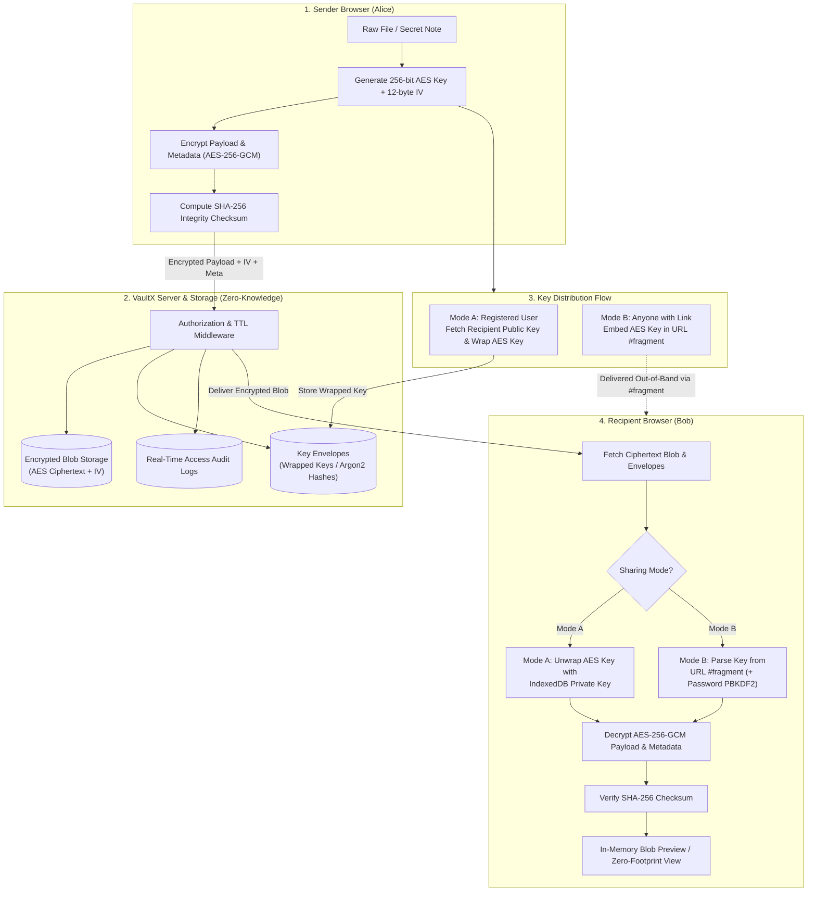

# VaultX — Zero-Knowledge File & Secret Sharing Platform

[](https://github.com)
[-red.svg)](https://github.com)
[](https://github.com)
[](https://nextjs.org/)
[](https://developer.mozilla.org/en-US/docs/Web/API/Web_Crypto_API)
[-brightgreen.svg)](test/run-all-tests.mjs)
[](LICENSE)

---

## 🔒 Executive Summary

Modern cloud storage providers and messaging applications mandate blind trust. Standard platforms encrypt files at rest on their servers while retaining full possession of the decryption keys, leaving files exposed to insider threats, subpoena requests, and server breaches. Files shared over permanent cloud links remain accessible indefinitely, and even when encrypted, critical metadata such as filenames, file types, and directory paths remain exposed in cleartext.

**VaultX** is a **zero-knowledge, end-to-end encrypted file and secret sharing platform** where all cryptographic operations (key generation, encryption, and decryption) take place **strictly inside the client's browser** via the native `window.crypto.subtle` Web Crypto API. The central server and database store only opaque ciphertext blobs and encrypted metadata envelopes. Even under a complete server, database, or network MITM compromise, attackers obtain nothing but unreadable AES-256-GCM ciphertext.

---

## ⚠️ The Problem & What Leaks Today

| Problem Vector | Current Industry Status Quo | VaultX Zero-Knowledge Resolution |
| :--- | :--- | :--- |
| **Server-Side Key Exposure** | Providers (Google Drive, Dropbox) hold keys server-side and can inspect files at will. | Keys are generated client-side and never sent to or stored on the server in plaintext. |
| **Metadata Leakage** | Filenames, extensions, and MIME types are stored in cleartext databases. | Full metadata is encrypted in the client envelope; the server never learns what file is shared. |
| **Permanent Link Risk** | Shared links stay active forever unless manually revoked, risking accidental leaks. | Enforced cryptographic TTL expiration timers (10 mins to 7 days) and auto-purge cron. |
| **Zero Sender Visibility** | Senders have no insight into who viewed files or how many times they were downloaded. | Real-time audit logs with client IP, user-agent, timestamp, and instant kill-switch revocation. |
| **Blind Third-Party Transfers** | Large files (>25MB) in email or chat backups silently route unencrypted through cloud services. | Pure in-browser binary chunking and encryption prior to network transmission. |

### Sensitive Data Protected
- **Identity & KYC Documents**: Aadhaar, PAN cards, Passports, Driver's Licenses.
- **Developer & DevOps Secrets**: `.env` configuration files, SSH private keys, API access tokens, certificates.
- **Financial & Medical Records**: Bank statements, tax filings, health records, lab reports.
- **Confidential Legal & Academic Work**: Non-disclosure agreements, contracts, unpublished manuscripts.

---

## ✨ Key Features & Innovations

### 1. Dual-Mode Cryptographic Sharing
* **Mode A: Registered Platform Users (Hybrid Asymmetric Cryptography)**
  * Recipient registers their public key (RSA-OAEP 2048-bit).
  * Sender generates a random 256-bit AES file key, encrypts the payload with AES-256-GCM, and wraps the AES key using the recipient's RSA-OAEP public key.
  * The recipient's browser decrypts the AES key locally using their private key, stored securely in browser **IndexedDB** (`extractable: false`).
  * Identity is verified through colon-separated SHA-256 public key fingerprints (`XX:XX:XX:...`).
* **Mode B: Anonymous / Public Link (#Fragment Key Delivery)**
  * For ad-hoc sharing without registration, the AES-256-GCM key is encoded in Base64URL and appended exclusively to the **URL Hash Fragment** (`https://.../v/<id>#<key>`).
  * Under **RFC 3986**, URL fragments are processed strictly client-side and **are never transmitted in HTTP requests** to the server, proxies, or CDN logs.
  * Optional **PBKDF2 (100,000 iterations)** passphrase derivation adds a second factor of authentication.

### 2. True Metadata Privacy
Filenames, file extensions, and MIME types are serialized into an encrypted metadata payload (`encryptedMetaB64`) with authenticated AES-GCM tags. The server only tracks a random UUID file identifier.

### 3. Zero-Footprint In-Memory Preview
Recipients can view PDFs, images, and text files directly inside the browser using secure in-memory `Blob` object URLs, eliminating the risk of leaving residual unencrypted copies on local disks.

### 4. Ephemeral Governance & Self-Destruct
* **Granular Expiry**: Configurable TTL timers ranging from 10 minutes to 7 days.
* **Download Limits**: Strict download quotas, including **1-view Burn-After-Reading** mode that permanently purges the ciphertext blob immediately upon download.
* **Instant Sender Kill-Switch**: One-click revocation from the sender's dashboard wiping key envelopes and invalidating access tokens (`410 Gone`).

### 5. Verifiable Zero-Knowledge (Live Server Hex Inspector)
Provides an interactive verification drawer displaying the exact raw ciphertext bytes and metadata stored on the server side-by-side with client-side plaintext, proving mathematically that the server possesses zero knowledge of file contents.

### 6. One-Time Secret Text Notes & QR Code Sharing
Senders can compose ephemeral notes, credentials, and passwords directly in the UI, encrypting the payload with instant QR code generation for secure air-gapped mobile viewing.

### 7. Zero External Crypto Dependencies
Built directly on standard browser **Web Crypto APIs** (`window.crypto.subtle`). Eliminates supply chain dependencies and protects against malicious package injections, backed by strict **Content Security Policy (CSP)** headers.

---

## 🏛️ System Architecture



---

## 🔬 Cryptographic Specification

| Component | Standard / Algorithm | Parameters / Implementation |
| :--- | :--- | :--- |
| **Symmetric Encryption** | AES-GCM (Authenticated) | 256-bit key, 12-byte cryptographically secure random IV, 128-bit authentication tag |
| **Asymmetric Wrapping** | RSA-OAEP | 2048-bit modulus, SHA-256 digest, `extractable: false` |
| **Passphrase Derivation** | PBKDF2 | SHA-256, 100,000 iterations, 16-byte random salt |
| **Integrity Verification** | SHA-256 | Full binary digest computed pre-encryption and re-verified post-decryption |
| **Key Storage** | Browser IndexedDB | Non-extractable Web Crypto CryptoKey handle |
| **Key Exchange (Link)** | URL Fragment Hash | Base64URL encoded; omitted from HTTP network requests (RFC 3986) |
| **Server Password Hash** | Argon2id / bcrypt | Salted, resistant to offline GPU dictionary attacks |

---

## 📂 Project Structure

```
vaultx/
├── README.md                      # Project documentation and specifications
└── vaultx-web/                    # Frontend client & zero-knowledge crypto application
    ├── app/
    │   ├── globals.css            # Dark-mode glassmorphic styling & cyber theme
    │   ├── layout.jsx             # Root layout with offline local font fallbacks
    │   ├── page.jsx               # Main upload studio, tabs, & key onboarding trigger
    │   ├── dashboard/             # Sender security dashboard, audit trail, & kill-switch
    │   └── v/[id]/                # Dynamic recipient decrypt view & in-memory preview
    ├── components/
    │   ├── CyberBackdrop.jsx      # Animated SVG cyber background
    │   ├── DecryptView.jsx        # In-browser decryptor, password challenge, previewer
    │   ├── KeySetupModal.jsx      # RSA-OAEP key generation & fingerprint onboarding
    │   ├── QRModal.jsx            # Dynamic QR code modal for mobile air-gapped viewing
    │   ├── TerminalWindow.jsx     # Glassmorphic terminal wrapper
    │   ├── ThemeSelect.jsx        # UI theme toggle
    │   ├── UploadCard.jsx         # Dual-mode file upload, note editor, and option toggles
    │   └── dashboard/
    │       ├── AuditTrail.jsx     # Real-time access log audit table
    │       ├── HexInspector.jsx   # Live server ciphertext inspector drawer
    │       └── RevokeButton.jsx   # One-click cryptographic revocation kill-switch
    ├── hooks/
    │   ├── useDecrypt.js          # Reactive state machine for retrieval, auth, & decryption
    │   └── useUpload.js           # Reactive state machine for client-side encryption & upload
    ├── lib/
    │   ├── api.js                 # REST API client with automatic offline mock failover
    │   ├── keyStore.js            # IndexedDB manager for non-extractable private keys
    │   └── vaultCrypto.js         # Core Web Crypto engine (AES-GCM, RSA-OAEP, PBKDF2, SHA-256)
    ├── scripts/
    │   ├── verify-crypto.mjs      # Standalone cryptographic pipeline verification
    │   └── verify-hooks.mjs       # Hook validation script
    └── test/
        ├── run-all-tests.mjs      # Comprehensive 4-tier E2E test runner (93 tests)
        ├── hooks-test.mjs         # Headless hook runner
        └── e2e/                   # 4-tier test specifications
```

---

## 🚀 Getting Started

### Prerequisites
* **Node.js**: v20 LTS or higher
* **Package Manager**: `npm` (v10+)

### 1. Clone & Install Dependencies

```bash
git clone https://github.com/your-username/vaultx.git
cd vaultx/vaultx-web
npm install
```

### 2. Environment Configuration

Create a `.env.local` file inside `vaultx-web/`:

```env
# URL for the VaultX backend server (default: local mock fallback)
NEXT_PUBLIC_API_URL=http://localhost:5000/api

# Set to true to force client-side offline mock mode without a running server
NEXT_PUBLIC_MOCK_BACKEND=false
```

> **Offline Resilience:** If `NEXT_PUBLIC_API_URL` is unreachable or the server is down, VaultX automatically transitions to an in-memory / `localStorage` mock store, enabling 100% offline hackathon demos.

### 3. Launch Development Server

```bash
npm run dev
```

Open [http://localhost:3000](http://localhost:3000) in your browser.

---

## 🧪 Verification & Test Suite

VaultX contains a test harness spanning **93 exhaustive automated tests across 4 tiers**:

```bash
cd vaultx-web
node test/run-all-tests.mjs
```

### Test Coverage Architecture
* **Tier 1: Feature Coverage (40 Tests)**: Validates Mode A/B encryption, key generation, SPKI PEM serialization, Base64URL encoding, API endpoints, mock failover, and Next.js routes.
* **Tier 2: Boundary & Corner Cases (40 Tests)**: Tests 0-byte files, 1-bit tampered ciphertext, checksum mismatches, corrupt public keys, wrong passwords, expired TTLs, download cap exhaustion, and strict CSP configuration.
* **Tier 3: Cross-Feature Combinations (8 Tests)**: Pairwise testing of Mode B + Password + Burn-After-Reading, Mode A + KeyStore persistence, multibyte payloads, and live failover.
* **Tier 4: Real-World Scenarios (5 Scenarios)**: Full end-to-end user journeys (ephemeral credential exchange, multi-megabyte encrypted documents, registered recipient transfers, and sender revocations).

```
======================================================================
                         TEST EXECUTION SUMMARY                       
======================================================================
  Suites:    4 passed, 4 total
  Tests:     93 passed, 0 skipped, 93 total
  Duration:  10868 ms
======================================================================
OVERALL RESULT: ALL TESTS PASSED (100% SUCCESS, Exit Code 0)
```

---

## 🎬 Live Hackathon Demo Walkthrough

### Scenario 1: Registered User Hybrid Flow (Alice ➔ Bob)
1. **Key Registration**: Bob opens VaultX and initializes his keypair via **Key Setup**. His browser generates an RSA-OAEP keypair, stores the private key in IndexedDB, and registers his public key with fingerprint `E4:A8:12:...`.
2. **Encrypted Send**: Alice selects **Mode A (Registered User)**, enters Bob's username, and attaches a sensitive document (`financial_report.pdf`). The browser fetches Bob's public key, encrypts the file with AES-256-GCM, and wraps the AES key with Bob's public key.
3. **Server Verification**: Alice opens the **Live Server Hex Inspector** to verify that the server holds only encrypted gibberish with zero visible metadata.
4. **Local Decryption**: Bob visits the link. His browser unwraps the AES key using his IndexedDB private key, validates the SHA-256 checksum, and renders an in-memory preview.

### Scenario 2: 1-View Burn-After-Reading Note (Mode B)
1. **Secret Creation**: Alice types an API key into the **Secret Note** tab, selects **1 View (Burn After Reading)**, and sets an optional passphrase.
2. **Key in Fragment**: Alice generates the link. The AES key is appended in the `#fragment` and never transmitted to the server.
3. **Recipient View**: The recipient clicks the link and enters the passphrase. The note decrypts in memory.
4. **Self-Destruct**: Upon page reload or second access, the server returns `410 Gone`. The blob has been purged from existence.

---

## 👥 Team QuadCore

Developed for **RAVENX 2026 | HACK4TECH** at GLA University under Problem Statement **PS-3: Cyber Security Track**.

| Role | Focus Area | Core Responsibilities |
| :--- | :--- | :--- |
| **Person 1** | Client Crypto & Key Vault | Native Web Crypto Engine, RSA-OAEP wrapping, IndexedDB keystore |
| **Person 2** | Backend & Auth Middleware | Node.js/Express API, TTL auto-purge, Argon2id, blob storage |
| **Person 3** | Core Frontend & UX | Next.js 14 App Router, reactive hooks (`useUpload`, `useDecrypt`), Tailwind CSS |
| **Person 4** | Security Dashboard & Verification | Audit trail, Live Server Hex Inspector, Kill-Switch, and QA |

---

## 📄 License

This project is licensed under the MIT License — see the [LICENSE](LICENSE) file for details.
